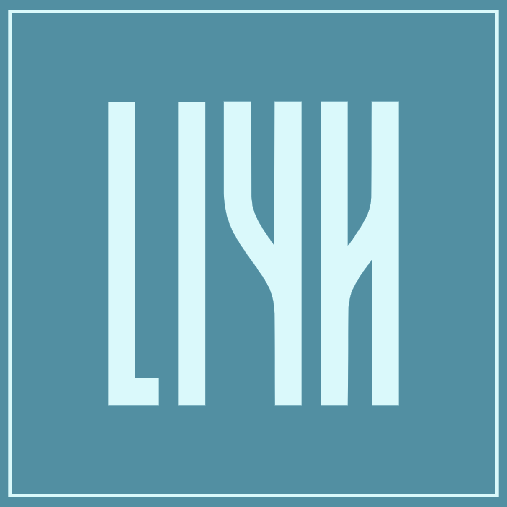

    <h1>ＬＩＹＨ</h1>

<i>Liyh</i> is a small, versatile and practical <a href="https://en.wikipedia.org/wiki/Computer_algebra_system">computer algebra system</a> for general purpose uses, but mainly focused on science, comming with a programming language with real programming capabilities and well-supplied libraries.

## Description
A *computer algebra system* (CAS) is usually a program that allows you to perform some operations on mathematical expressions symbolically, just as you would on paper without a numerical calculator, including tasks like simplification, differentiation, integration, and solving equations. Of course, you can also perform purely numerical operations and plotting.

You might know [Mathematica](https://en.wikipedia.org/wiki/Wolfram_Mathematica), [Sympy](https://en.wikipedia.org/wiki/SymPy) or [Maple](https://en.wikipedia.org/wiki/Maple_(software)) to name but a few. They are example of such computer algebra system. Liyh aims to be one of them.

A CAS generally comes with a little associated language for querying the symbolic engines. Liyh currently defines such a DSL (domain specific language), but plans to make it more general for the future (maybe as another side project).

## Project status
Liyh is in the construction and design phase. It is not yet ready for use (and has not *yet* been designed for anyway).

## Objectives
Liyh in no way claims to be a solution to anything, but simply adds to the computer algebra system collection by featuring the following *objectives*:

 - Be totally free, open-source and well documented ;
 - Be cross-platform and accessible from the web ;
 - Be easy to use for programmers and non-programmers ;
 - Be specifically useful for natural science ;
 - Offering ready-to-use and academic-quality rendering ;
 - Be fast enough for reasonably-sized calculations ;
 - Be high-level (no memory management, pointers, etc.) ;
 - Be type-safe (and unit-safe!) ;
 - Be community-minded ;
 - Be cool and fun to use.

Other objectives may follow in the future!

## Computer algebra capabilities
The list below represents the symbolic computing domains in which Liyh can be used:

 - Simplification, reduction and expansion ;
 - Calculus (limits, derivatives, primitives, integrations, ...) ;
 - Vector calculus (differential operators, multidimensional integrals, ...) ;
 - Abstract algebra (including: *see just below*) ;
 - Set theory ;
 - Linear algebra ;
 - Tensor algebra ;
 - Equation solving (algebraic, diophantine, differential, functional, ...) ;
 - Probabilities and statistics ;
 - Numerical analysis ;
 - 2D and surface plotting ;
 - Unit conversion ;
 - Automatic error propagation.

> [!IMPORTANT]
> It's important to note, however, that not every symbolic problem present any symbolic solution (see for example the [Richardson's theorem](https://en.wikipedia.org/wiki/Richardson%27s_theorem)) or that Liyh doesn't implement them.
> 
> Liyh *doesn't solve problems for you*, it assists you in your task. 😉

## Programming language capabilities
***TODO***

## Current implementation choices

The project is mainly written in [F#](https://fsharp.org/) and therefore run wherever `dotnet` runs, but there is a web version of the project as well as binaries and packages.

At the moment, it has been chosen that the implementation is not based on any other existing library as far as numerical or symbolic processes are concerned for the following reasons:

 - The few symbolic libraries that exist in the .NET environment are, to our knowledge, unsatisfactory, incomplete, not advanced enough or difficult to integrate into our project ;
 - We want to have control over the implementation of core features. What's more, it makes the project further self-contained and also makes licensing easier.
 - This is a very interesting and fun exercise for the author.

## Why does Liyh exists?
At the beginning of the adventure (near 2020), the initiative sprang from the desire to create a satire of [Wolfram|Alpha](https://www.wolframalpha.com/), by proposing a similar service but without any financial requirements, namely the solution of some math problems (equations, integrals, limits, ...) in a few solution steps.

The evolution of this enterprise has taken on a more substantial ambition, evolving towards the design of a comprehensive computation system, going quite beyond its initial parody function. Also, the author is interested in this field and wanted to learn more by creating such a system by himself. Unfortunately, the resolution steps are not provided with Liyh (in fact, it's either not trivial to do if you want to do it generically, or very tedious to do if you want to do it on a case-by-case way).

Liyh is not intended to solve any particular problem, but to add to the list of CAS to make it more diversified.

## How to pronounce "Liyh"?
Actually, just like "li". This doesn't refer to "Lie" groups or algebras, but to a blue flower that grows on rocks near rivers.

## Ressources 📚
We provide some resources that are of interest or have helped in the implementation of certain Liyh features, you can check out [here](/Ressources/README.md).

## Every contribution is worthwhile 💪
Don't hesitate to make your contribution to the project. Even the smallest report of spelling mistakes will be appreciated. If you have any other suggestions for the project, we will be happy to hear from you.

## Credits & acknowledgements
Persons:

 - [Mesa le bg 🐱](https://github.com/Mesabloo) for his ideas, encouragement and presence.
 - My cat 🐈 for his purrs and his sweet little face. So cute!

## License 📜

**Liyh** (the language's **compiler** AND **symbolic engines**) is licensed under [3-Clause BSD License](https://opensource.org/license/bsd-3-clause) (copyright 2024 vanaur) BUT uses the following third-party libraries:

 - [BenchShark](https://github.com/JamesMenetrey/BenchShark?tab=License-1-ov-file) (MIT License -- Copyright (c) Jämes Ménétrey): *A lightweight library for benchmarking performance of your .NET applications* ;
 - [FParsec](https://github.com/stephan-tolksdorf/fparsec) (Simplified BSD License -- Copyright (c) Stephan Tolksdorf): *A parser combinator library for F#* ;
 - [PrettyPrompt](https://github.com/waf/PrettyPrompt) (Mozilla Public License Version 2.0 -- Copyright (c) Will Fuqua): *A cross-platform command line input library that provides syntax highlighting, autocompletion, history and multi-line input* ;
 - [Spectre.Console](https://github.com/spectreconsole/spectre.console) (MIT License -- Copyright (c) Patrik Svensson, Phil Scott, Nils Andresen): *A .NET library that makes it easier to create beautiful console applications* ;
 - [ScottPlot](https://github.com/ScottPlot/ScottPlot) (MIT License -- Copyright (c) Scott Harden / Harden Technologies, LLC): *Interactive plotting library for .NET*.
 - [Plotly.NET](https://github.com/plotly/Plotly.NET/) (MIT License -- Copyright (c) Kevin Schneider, Timo Mühlhaus): *Interactive graphing library for .NET programming languages*.
 - [BenchmarkDotNet](https://github.com/dotnet/BenchmarkDotNet) (MIT License -- Copyright (c) .NET Foundation and contributors): *Powerful .NET library for benchmarking*.

**Liyh's standard library** will be licensed under [Apache 2.0](https://opensource.org/license/apache-2-0) (copyright 2024 vanaur).

**Liyh's documentation and tutorials** will be licensed under [CC BY-SA 4.0](https://creativecommons.org/licenses/by-sa/4.0/) (copyright 2024 vanaur).

In a nutshell:
 - If you simply want to write a project in Liyh (including the standard library), then you're free to choose any license you like for your project, mentioning that you have used Liyh.
 - If you want to include Liyh in your project, you can choose any license compatible with the above terms.
 - You can share and adapt Liyh's documentation / tutorials according to the *CC BY-SA 4.0* terms.
